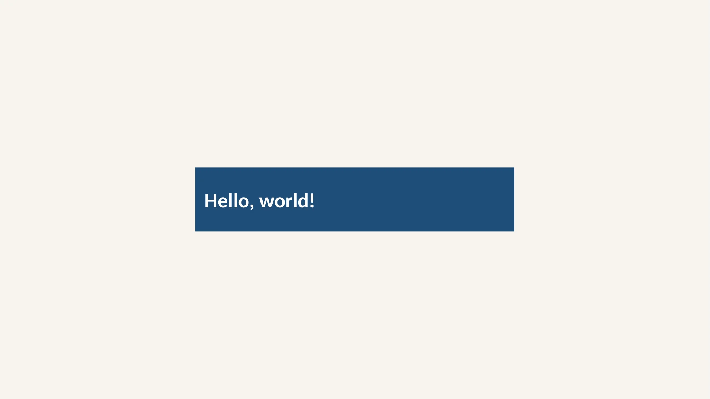
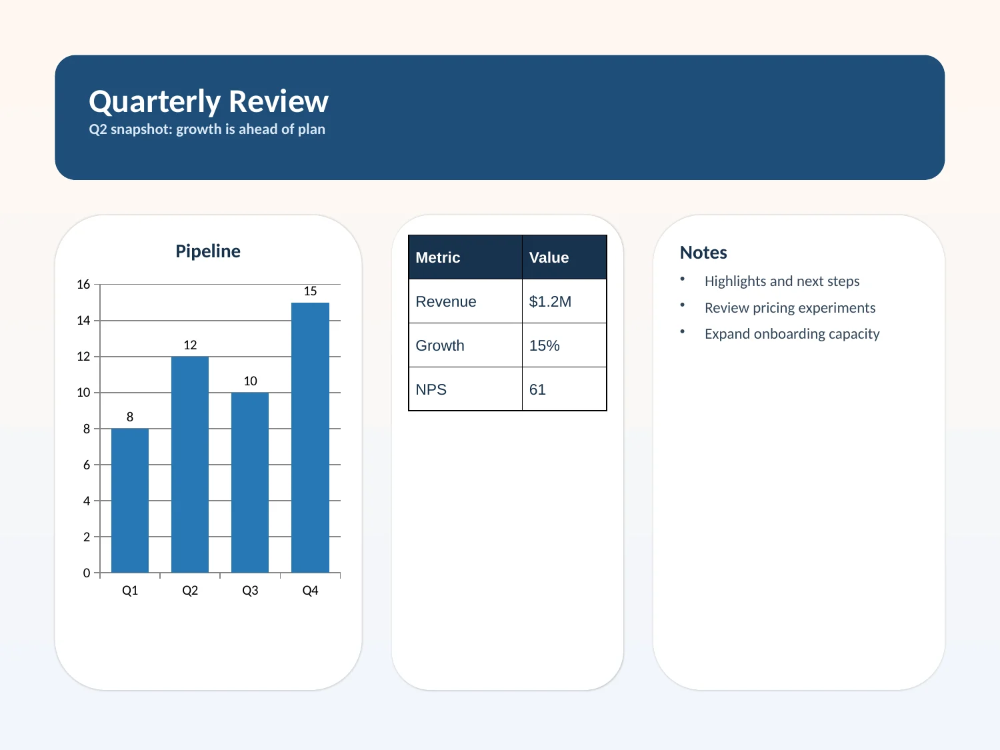

# @pixel/pptx

Library for generating PPTX files with a JSX-first layout DSL that lowers to
layout, scene, and OOXML. Runs on Deno and Node; an imperative, JSX-free API is
available for plain JavaScript.

## Install

```bash
deno add jsr:@pixel/pptx      # Deno
npx jsr add @pixel/pptx       # Node (npm); pnpm, yarn, and bun also support jsr
```

The package is ESM-only. For JSX, use `@pixel/pptx` as the JSX import source:

```json
{
  "compilerOptions": {
    "jsx": "react-jsx",
    "jsxImportSource": "@pixel/pptx"
  }
}
```

## Minimal Example

```tsx
/** @jsxImportSource @pixel/pptx */

import {
  Align,
  clr,
  generate,
  Presentation,
  Slide,
  Text,
  u,
} from "@pixel/pptx";

const heroStyle = {
  fill: { kind: "solid", color: clr.hex("1F4E79") },
  verticalAlign: "middle",
  padding: u.in(0.18),
  fontSize: u.font(28),
  fontColor: clr.hex("FFFFFF"),
  bold: true,
};

const deck = (
  <Presentation title="Hello deck">
    <Slide background={{ kind: "solid", color: clr.hex("F7F4EE") }}>
      <Align x="center" y="center" w={u.in(6)} h={u.in(1.2)}>
        <Text.P style={heroStyle}>Hello, world!</Text.P>
      </Align>
    </Slide>
  </Presentation>
);

Deno.writeFileSync("hello.pptx", generate(deck));
```

Preview rendered from [`examples/minimal.tsx`](./examples/minimal.tsx).



## Showcase

Full source: [`examples/quarterly-review.tsx`](./examples/quarterly-review.tsx)



## Imperative API (no JSX)

The declarative JSX API above is recommended. For plain JavaScript, or code
coming from PptxGenJS, `@pixel/pptx/imperative` places items at absolute
positions and builds the same components underneath:

```js
import { writeFileSync } from "node:fs";
import { clr, u } from "@pixel/pptx";
import { createPresentation } from "@pixel/pptx/imperative";

const pres = createPresentation({ title: "Q2 review" });
pres.addSlide({ background: clr.hex("F7F4EE") })
  .addText("Quarterly Review", {
    x: u.in(0.5),
    y: u.in(0.4),
    w: u.in(9),
    h: u.in(1),
    style: { fontSize: u.font(32), bold: true },
  })
  .addBarChart({
    x: u.in(0.5),
    y: u.in(1.6),
    w: u.in(5),
    h: u.in(3.5),
    data: [{ q: "Q1", v: 8 }, { q: "Q2", v: 12 }],
    category: "q",
    series: [{ name: "Pipeline", value: "v" }],
  });

writeFileSync("review.pptx", pres.generate());
```

Slides support `addText`, `addShape`, `addImage`, `addTable`, `addBarChart`,
`addLineChart`, `addPieChart`, `addDonutChart`, and `add(node, placement)` for
placing any component tree (e.g. `Row({ children: [...] })`) in a frame. Options
are the matching component props plus `x`, `y`, `w`, and `h`.

## Public API

### Core exports

- `generate(<Presentation>...</Presentation>)`
- `u.*` for units: `in`, `cm`, `pt`, `emu`, `font`, `pct`
- `clr.hex(...)` for validated OOXML colors
- `<Presentation size>`: `"16:9"` (default, PowerPoint Widescreen), `"4:3"`, or
  `{ width, height }`
- Inherited layout defaults through `presentation layout={...}` and
  `slide layout={...}`

### Structural JSX components

- `<Presentation>`
- `<Slide>` — `notes` adds speaker notes
- `<Row>`
- `<Row.Start>`
- `<Row.End>`
- `<Column>`
- `<Column.Start>`
- `<Column.End>`
- `<Stack>`
- `<Align>`
- `<Positioned>`

### Content JSX components

- `<Text>` — multi-paragraph text body (`gap` for paragraph spacing)
- `<Text.P>` — single paragraph; auto-creates a text body at the top level
- `<Shape preset="...">` — `preset` is a typed DrawingML preset geometry name
  (`PresetGeometry`)
- `<Image data={bytes} />` — PNG, JPEG, GIF, or BMP; the format is detected from
  the bytes
- `<Table cols=[...]>`
- `<Table.Row height={...}>`
- `<Table.Cell>`
- `<Chart.Bar ... />`
- `<Chart.Line ... />`
- `<Chart.Pie ... />`
- `<Chart.Donut ... />`

### Text JSX components

- Raw string and number children create text directly inside `<Text.P>`
- `<Text.Span>` is optional — bare strings inside `<Text.P>` work directly
- `gap={...}` on `<Text>`, `<Shape>`, and `<Table.Cell>` inserts paragraph-block
  spacing
- Inline components: `<Text.Span>`, `<Text.Link href="...">`, `<Text.Bold>`,
  `<Text.Italic>`, `<Text.Underline>`

### Styling model

- Style props are plain typed objects, not special builder tokens
- `style` accepts either one style object or an array of style objects
- Later style entries win, with nested objects merged structurally
- Backgrounds, fills, lines, shadows, bullets, and image options are plain data
- `background` takes a hex color, a fill, or `{ data, fit, crop, alpha }` for an
  image
- Opacity (`alpha`), gradient stop positions, and crops are `u.pct(...)` values;
  angles are degrees
- Charts use `data`, `category`, and `series=[...]`, with one or more series for
  bar/line and exactly one series for pie/donut

### Placement model

- `basis`, `grow`, `alignSelf`, `aspectRatio`, `w`, and `h` apply directly to
  children inside `<Row>` and `<Column>`
- `<Row.Start>/<Row.End>` and `<Column.Start>/<Column.End>` express split
  layouts without spacer or push props
- `<Positioned x y w h>` is the explicit parent-relative absolute placement
  wrapper
- `<Positioned>` children inside `<Row>` and `<Column>` do not consume flow
  space
- `<Align>` remains the explicit single-child alignment wrapper
- `presentation layout={...}` and `slide layout={...}` provide inherited
  defaults for slide padding, row/column gap, stack padding, and text gap

## Validation

Run the full local checks before committing:

```bash
deno check mod.ts
deno lint
deno fmt --check
deno task test
deno publish --dry-run
```

Tests validate every generated deck against the ECMA-376 schemas, the Open XML
SDK, python-pptx, and LibreOffice. They need `scripts/fetch-spec` to have been
run once, plus `uv`, `dotnet`, `node`, and LibreOffice on `PATH`.
